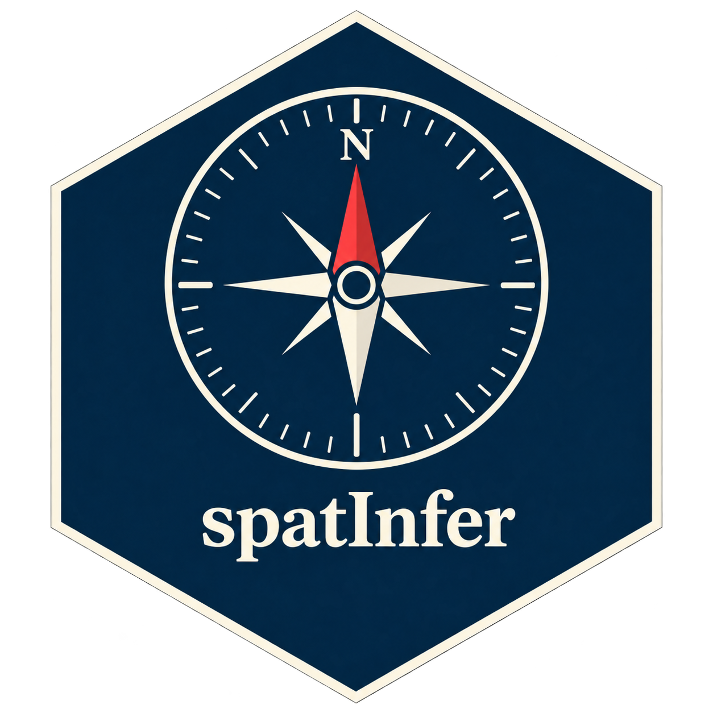

<!-- README.md is generated from README.Rmd. Please edit that file -->

```{r, include = FALSE}
knitr::opts_chunk$set(
  collapse = TRUE,
  comment = "#>",
  fig.path = "man/figures/README-",
  out.width = "100%"
)
```

# spatInfer 

<!-- badges: start -->

<!-- badges: end -->

Strong autocorrelation and directional trends mean that regressions using spatial observations are prone to return inflated t-statistics regardless of the validity of their identification procedure. The purpose of `spatInfer` is to offer a simple workflow to obtain reliable estimates from spatial regressions. A spline basis serves to control for trends or other large scale spatial structure. To provide reliable inference, three modern standard error corrections are implemented (Bester-Conley-Hansen, Ibragimov-Mueller, and Mueller-Watson) with the optimal tuning parameter for each chosen by a spatial noise placebo.

## Workflow.

`spatInfer` is based on a sequence of three steps.

1.  `optimal_basis()` gives the spatial basis parameters to include in regressions.

2.  `placebo_synth()` generates spatial noise placebos to estimate treatment significance and select the optimal tuning parameter of each correction: the number of clusters for Bester-Conley-Hansen and Ibragimov-Mueller, and the bound on average correlation `avc` for Mueller-Watson. It also tests the null hypothesis that the outcome is trending spatial noise, and therefore independent of the treatment.

3.  `regression_table()` displays the regression results for the three standard error correction procedures alongside uncorrected estimates.

This procedure is also implemented for instrumental variables.

## Tutorial

A step by step tutorial for least squares regressions can be found [here](https://morganwkelly.github.io/spatInfer_tutor/), and one for instrumental variable regressions [here](https://morganwkelly.github.io/spatInfer_tutor/tutorial_iv.html).

## Installation

You can install spatInfer from [GitHub](https://github.com/) with:

``` r
# install.packages("pak")
pak::pak("morganwkelly/spatInfer")
```
